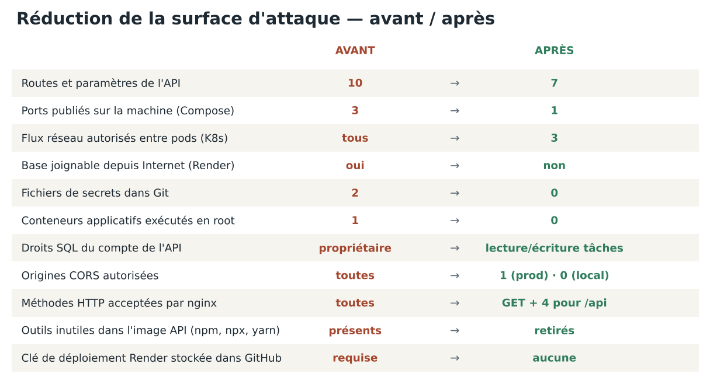

# Sécurité et réduction de la surface d'attaque

Ce document applique au DevOps Tasks Board la méthode d'audit du cours INF48 :
**recenser** la surface d'exposition, **dérouler** la checklist, **documenter**
chaque constat, **prioriser** (impact × probabilité), puis **corriger et vérifier**.
Chaque mesure indique si elle est *en place* et *testée*, avec la preuve à montrer.



## 1. Définitions

- **Surface d'attaque** : ensemble des points d'entrée par lesquels l'application
  peut être attaquée — routes d'API, formulaires, ports réseau, dépendances,
  comptes, secrets.
- **La réduire**, c'est supprimer ce qui ne sert pas et limiter ce qui reste
  exposé. Une surface plus petite ne garantit pas l'absence de faille, mais
  laisse moins d'endroits où en chercher et concentre la surveillance sur
  l'essentiel.
- **Principe de moindre privilège** : chaque composant n'a que les droits
  strictement nécessaires à son rôle.
- **Défense en profondeur** : plusieurs protections indépendantes empilées
  (réseau, conteneur, application, données), pour qu'une barrière franchie ne
  suffise pas.

## 2. Recenser la surface d'exposition

### Points d'entrée applicatifs

| Point d'entrée | Utilisé par | Décision |
|---|---|---|
| `GET /health` | Sondes Kubernetes, Render | Conservé, ne touche pas la base |
| `GET /ready` | Sonde de disponibilité Kubernetes | Conservé, réponse générique |
| `GET /projects` | Frontend (liste des projets) | Conservé |
| `GET /tasks` | Frontend (tableau) | Conservé, **paramètres `project_id` et `status` supprimés** (le filtrage se fait dans le navigateur) |
| `POST /tasks` | Formulaire « Nouvelle tâche » | Conservé, validation stricte |
| `PATCH /tasks/:id` | Flèches de déplacement | Conservé, validation stricte |
| `DELETE /tasks/:id` | Bouton de suppression | Conservé, identifiant contrôlé |
| `POST /projects` | **Personne** | **Supprimé** |

Bilan : 10 points d'entrée (8 routes + 2 paramètres) → **7**, soit 30 % de moins.
Toute autre adresse renvoie 404.

### Exposition réseau

| Environnement | Avant | Après |
|---|---|---|
| Docker Compose | 3 ports publiés sur toutes les interfaces (5173, 3001, 5433) | **1 seul** (8080, le frontend). API et base injoignables depuis la machine. Base sur un réseau Docker `internal` sans accès Internet |
| Kubernetes | Tous les pods peuvent se parler | NetworkPolicy « tout refuser », puis **3 flux** ouverts : extérieur → frontend, frontend → backend, backend → base |
| Render | Base joignable depuis Internet avec son mot de passe | `ipAllowList: []` : **aucune** connexion depuis Internet, seule l'API (réseau privé Render) y accède |

### Données stockées

- Tâches et projets : aucune donnée personnelle prévue, mais le texte libre peut
  en contenir (noms, informations sur des personnes).
- Journaux : adresse IP des visiteurs, **tronquée** (dernier octet masqué).
- Secrets : mots de passe de la base, uniquement dans `.env` (local, non versionné),
  le Secret Kubernetes (créé depuis `.env`) et les variables Render.

### Composants et dépendances

| Élément | Mesure de réduction |
|---|---|
| Dépendances de production du backend | 5 bibliothèques, toutes utilisées ; `dotenv` supprimé (Node 22 lit `.env` nativement) |
| Image Docker de l'API | npm, npx, yarn et corepack **retirés** de l'image finale ; dépendances de développement exclues ; code en lecture seule |
| Image Docker du frontend | Ni Node, ni `node_modules`, ni code source : uniquement les fichiers compilés et nginx |
| Frontend | Aucune police, aucun script, aucune icône chargés depuis un service tiers |
| Pipeline | Actions tierces épinglées par empreinte SHA ; aucune clé Render stockée dans GitHub |

## 3. Constats, priorisation et correctifs

Impact et probabilité sont notés faible / moyen / élevé. La priorité suit la
matrice du cours : élevé × élevé = priorité maximale.

| # | Constat (localisation) | Catégorie OWASP | Impact | Proba. | Priorité | Correctif | En place | Testé — preuve |
|---|---|---|---|---|---|---|---|---|
| C1 | Identifiant non numérique → erreur 500 (`DELETE /tasks/abc`) | Validation des entrées | Moyen | Élevée | Rapide | `parseId` : entier positif uniquement → 400 | Oui | Oui — `test/unit.test.js` ; `curl -X DELETE …/tasks/abc` → 400 |
| C2 | Champs non limités, champs inconnus acceptés | Validation des entrées | Moyen | Élevée | Rapide | Liste blanche : champs autorisés, longueurs max (120 / 500), valeurs en liste ; contraintes `CHECK` en base | Oui | Oui — tests unitaires (champ `is_admin` refusé) |
| C3 | Aucune limite de requêtes | Attaques ciblées (DoS applicatif, abus) | Élevé | Moyenne | Rapide | `express-rate-limit` : 120 req/min par IP, 30 écritures/min ; corps JSON ≤ 10 Ko ; requêtes SQL coupées à 5 s | Oui | Oui — 31ᵉ écriture → 429, événement `rate_limited` dans les logs |
| C4 | Détail technique dans les réponses d'erreur (`/ready` renvoyait le message SQL) | Mauvaise configuration | Moyen | Moyenne | À traiter | Messages génériques ; détail uniquement dans les logs | Oui | Oui — JSON invalide → « JSON invalide. » sans trace |
| C5 | En-têtes révélant la technologie (`X-Powered-By`, version nginx) ; aucun en-tête de sécurité | Mauvaise configuration | Faible | Élevée | À traiter | `helmet` côté API ; `server_tokens off` et CSP, `X-Frame-Options`, `nosniff`… côté nginx et Render | Oui | Oui — test unitaire ; `curl -I` |
| C6 | CORS ouvert à toutes les origines | Contrôle d'accès | Moyen | Moyenne | À traiter | Liste blanche `CORS_ORIGIN` : aucune origine en local, l'URL du frontend en production | Oui | Oui — test unitaire (origine pirate refusée) |
| C7 | L'API utilise le compte propriétaire de la base | Moindre privilège | Élevé | Faible | À surveiller → corrigé | Compte `app_user` : lecture des projets, lecture/écriture des tâches, aucun droit sur la structure | Oui (local, K8s, CI) | Oui — test d'intégration : `DROP TABLE` refusé |
| C8 | Secrets versionnés (`secrets.yaml`, mots de passe dans `docker-compose.yml`) | Défauts cryptographiques / secrets | Élevé | Moyenne | Rapide | `.env` non versionné généré avec des mots de passe aléatoires ; Secret K8s créé par script ; `gitleaks` dans la CI | Oui | Oui — job `secrets` de la CI |
| C9 | Ports de l'API et de la base publiés sur la machine | Surface d'attaque réseau | Moyen | Moyenne | À traiter | Un seul port publié ; réseau interne pour la base | Oui | Oui — `docker compose ps` : seul 8080 apparaît |
| C10 | Aucun cloisonnement entre pods | Surface d'attaque réseau | Élevé | Faible | À surveiller → corrigé | NetworkPolicies + Calico | Oui | Oui — un pod de test ne joint pas `postgres-service` (voir README) |
| C11 | Conteneur frontend en root, systèmes de fichiers modifiables | Sécurité des conteneurs | Moyen | Faible | À planifier → corrigé | nginx unprivileged ; `readOnlyRootFilesystem`, `drop: ALL`, `no-new-privileges`, seccomp | Oui | Oui — `kubectl exec … -- id` → uid 101 |
| C12 | Base Render joignable depuis Internet | Surface d'attaque réseau | Élevé | Moyenne | Priorité maximale | `ipAllowList: []` ; initialisation par l'API au démarrage | Oui | Oui — `psql` depuis le poste refusé tant que l'IP n'est pas ajoutée |
| C13 | Déploiement en production même si les tests échouent | Intégrité logicielle | Élevé | Moyenne | Rapide | `autoDeployTrigger: checksPass` : Render attend les contrôles verts | Oui | Oui — un commit au test cassé n'est pas déployé |
| C14 | Dépendances et images non analysées | Composants vulnérables | Élevé | Moyenne | Rapide | `npm audit` (prod, niveau high) ; Trivy sur les images et la configuration ; Dependabot | Oui | Oui — journaux de la CI |

## 4. Vérifier : commandes de preuve

```bash
# C1 — identifiant invalide : 400 et non 500
curl -s -o /dev/null -w "%{http_code}\n" -X DELETE http://localhost:8080/api/tasks/abc

# C3 — limitation de débit : les dernières réponses passent à 429
for i in $(seq 1 35); do curl -s -o /dev/null -w "%{http_code} " -X POST \
  http://localhost:8080/api/tasks -H 'Content-Type: application/json' \
  -d '{"title":"test","project_id":1}'; done

# C5 — en-têtes de sécurité
curl -sI http://localhost:8080 | grep -iE "content-security|x-frame|nosniff|server"

# C7 — moindre privilège en base
docker compose --env-file .env -f infra/docker/docker-compose.yml exec db \
  psql -U app_user -d tasksdb -c "DROP TABLE tasks;"   # → must be owner of table tasks

# C9 — un seul port publié
docker compose --env-file .env -f infra/docker/docker-compose.yml ps

# Scan dynamique (DAST) OWASP ZAP, non intrusif
docker run --rm -t zaproxy/zap-stable zap-baseline.py -t https://<frontend>.onrender.com
```

## 5. Risques résiduels (assumés et documentés)

| Risque | Pourquoi il reste | Mesure compensatoire / suite |
|---|---|---|
| Pas d'authentification | Le sujet décrit un tableau partagé, sans comptes utilisateurs | Rate limiting, validation stricte, CORS ; étape suivante : authentification OIDC et rôles (lecteur / contributeur) |
| Certificat de la base Render non vérifié (`rejectUnauthorized: false`) | Certificat signé par une autorité interne à Render | Connexion chiffrée et réseau privé ; vérification possible en fournissant le certificat d'autorité |
| Conteneur PostgreSQL démarré en root | L'image officielle démarre en root puis passe sur l'utilisateur `postgres` | `allowPrivilegeEscalation: false`, seccomp, aucun port exposé |
| CSP Render : `connect-src https://*.onrender.com` | L'URL exacte de l'API n'est connue qu'après sa création | La restreindre à l'URL exacte une fois connue |
| Sur Render, l'API utilise le compte propriétaire de la base | L'API crée elle-même le schéma au démarrage (base inaccessible depuis Internet) | Base non joignable (`ipAllowList: []`) ; suite : créer `app_user` sur Render et ne garder le compte propriétaire que pour l'initialisation |
| Plan gratuit Render : pas de sauvegarde, base expirant à 30 jours | Limite de l'offre | Restauration automatique du schéma au démarrage ; `bootstrap_db.sh` ; plan payant avec sauvegardes en production |

## 6. Données personnelles et incident

- **RGPD** : hébergement Render en région Frankfurt (UE). Journaux sans corps de
  requête ni secret, IP tronquée. Pas de compte utilisateur, donc pas de mot de
  passe stocké.
- **Incident** : réponse en 6 étapes (SANS PICERL) — préparation, identification,
  confinement (suspendre le service Render, révoquer les mots de passe),
  éradication, rétablissement (redéploiement par le pipeline), retour
  d'expérience. En cas de violation de données personnelles : notification à la
  CNIL sous **72 heures** (RGPD, article 33).
